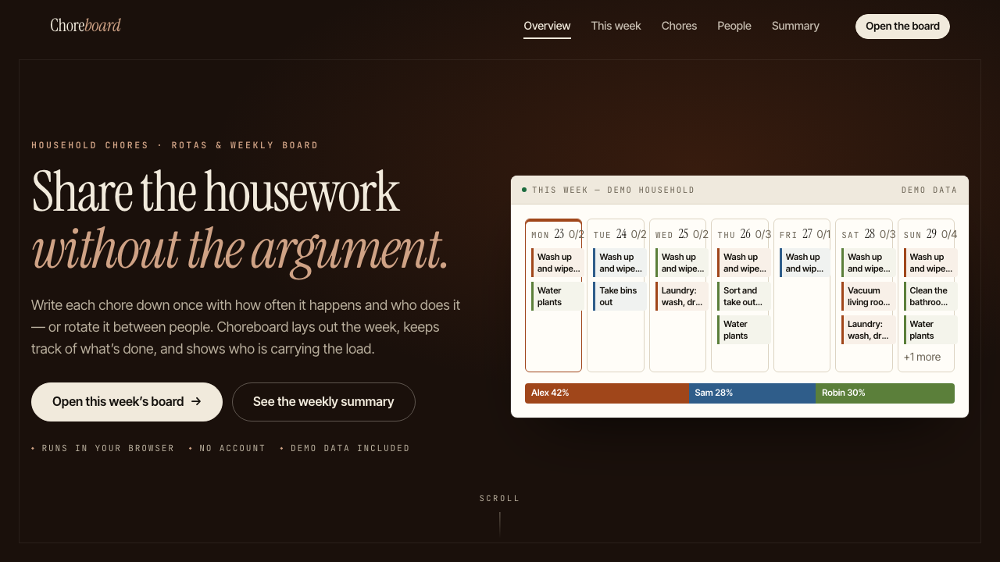
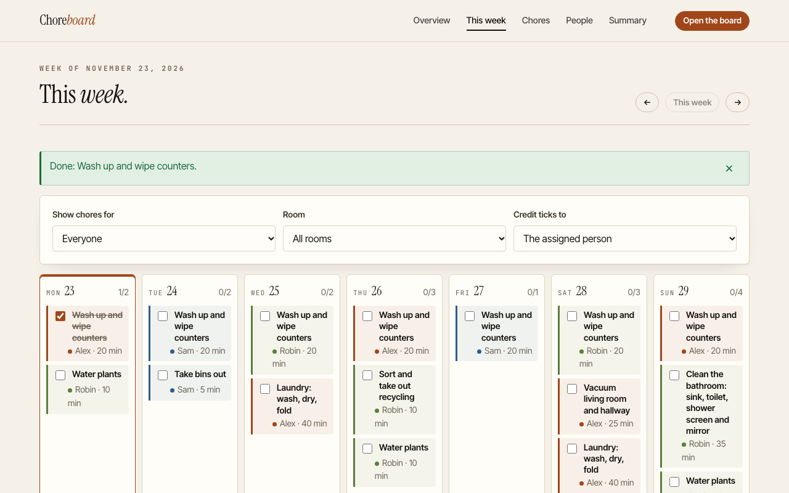
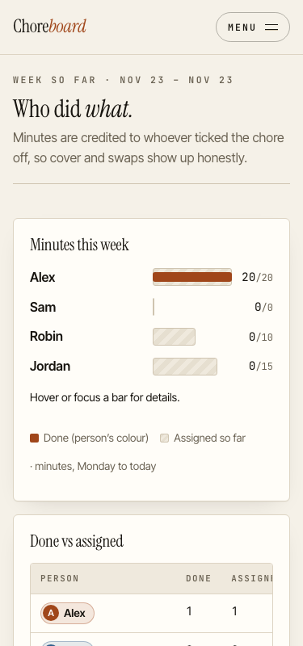

# Choreboard

Household chores with schedules, fixed owners or rotations, a weekly board to tick them off, and a summary of who actually did the work.

**Live demo:** [https://choreboard.vercel.app/](https://choreboard.vercel.app/) — runs entirely in your browser; demo data is fictional and labelled.



| Weekly board | Mobile summary |
| --- | --- |
|  |  |

## Run it

```bash
npm install
npm run dev        # http://localhost:5202
npm test
npm run build
npm run test:e2e   # Playwright smoke test (npm run e2e:install once if Chromium is missing)
```

## Main workflow

1. The app opens with a labelled **demo household**: three people, nine chores and three weeks of history, with a few chores missed this week. **Chores → Clear demo household** removes it all.
2. **People** → add everyone who shares the chores. Each person gets a colour (changeable) and a planned share of weekly minutes.
3. **Chores → Add chore** → room, minutes, start date, a schedule (every day, chosen weekdays, or every N days), and either one person or a rotation in a chosen order.
4. **This week** → a seven-day board. Tick chores as they’re done, filter by person or room, browse previous or next weeks, and credit a tick to someone other than the assignee. Chores missed in the last seven days are listed with **Mark done**.
5. **Summary** → done vs assigned minutes per person for the week so far (chart with legend and tooltips) and a table with each person’s planned share.

## Rules

- Rotations advance each time the chore comes round, counted from its start date, so a Monday/Thursday chore alternates between people even across weeks.
- Future days can’t be ticked. Today is never “missed”; earlier unticked days are.
- Minutes are credited to whoever ticked the chore, which may differ from the assignee.
- **Planned share** = each person’s expected weekly minutes from the chore definitions; rotating chores are split evenly.
- Removing a person unassigns their fixed chores and drops them from rotations.

## Design

Shared editorial system: Instrument Serif display type, Inter Tight interface text, mono day labels, each person’s colour carried through chips, task borders and charts, an ink hero whose preview is the real board component, and a warm paper workspace. Motion (staggered days, growing bars, scroll reveals, route cross-fades) is disabled under `prefers-reduced-motion`.

## Tests

- `src/lib/chores.test.ts` — daily, weekly and every-N schedules, labels, rotation by occurrence, removing people, toggling and crediting, weekly summaries, missed chores, planned share, validation.
- `src/App.test.tsx` — ticking today, refusing future days, creating a rotating chore with validation, clearing demo data, people validation and the summary chart.
- `e2e/smoke.spec.ts` — landing, tick with reload persistence, add a person, add an every-30-days chore, summary, plus 375px layout checks.

## Limitations

- One shared copy per device; no accounts or syncing between phones.
- No reminders or notifications.
- Editing a chore’s schedule or rotation re-interprets past weeks.

## Future improvements

- Export the week as a printable rota, and swap requests between people.

## Licence

MIT — see [LICENSE](LICENSE).
